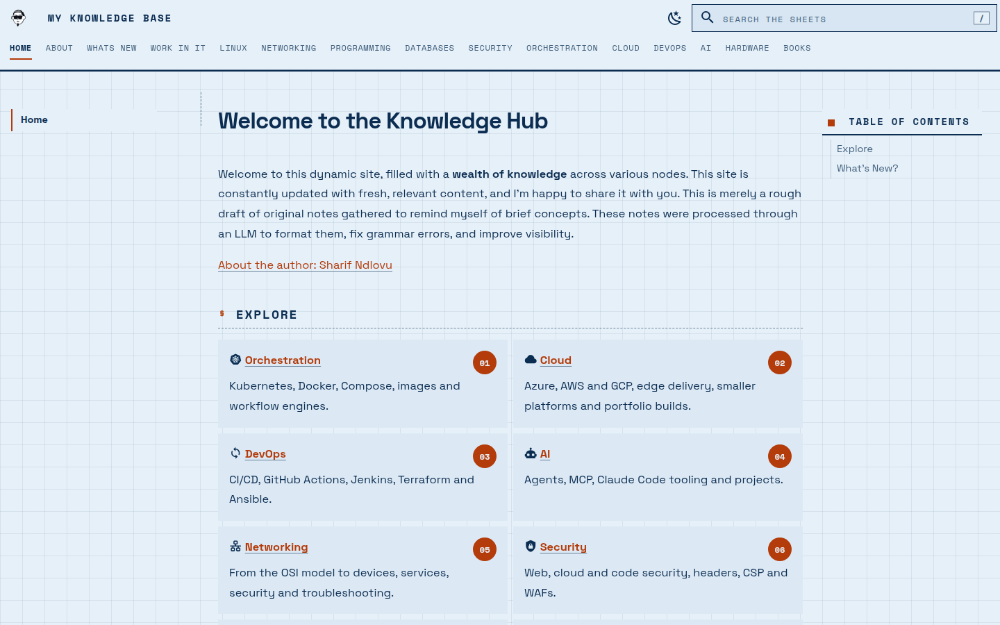
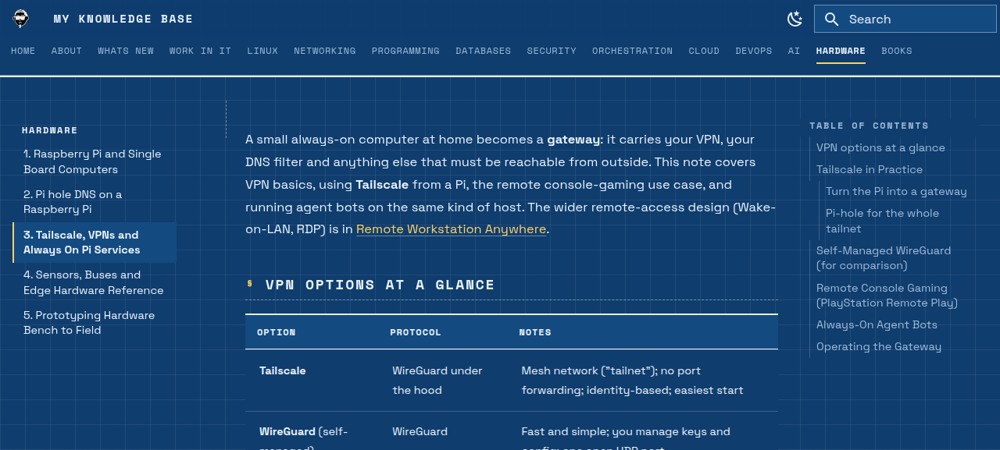
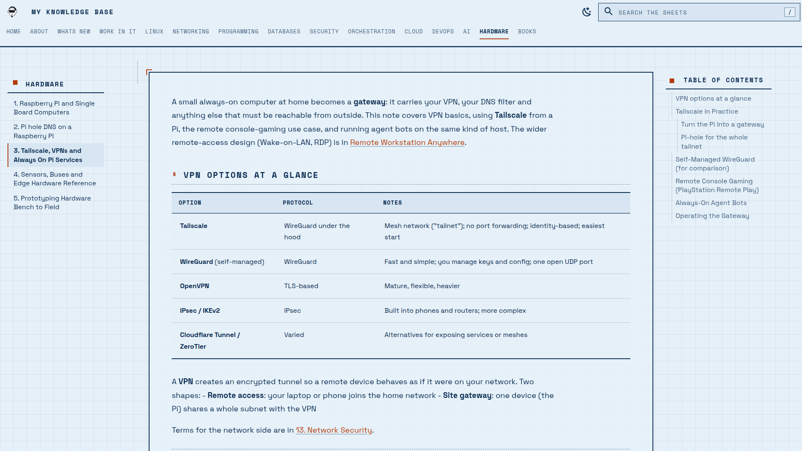
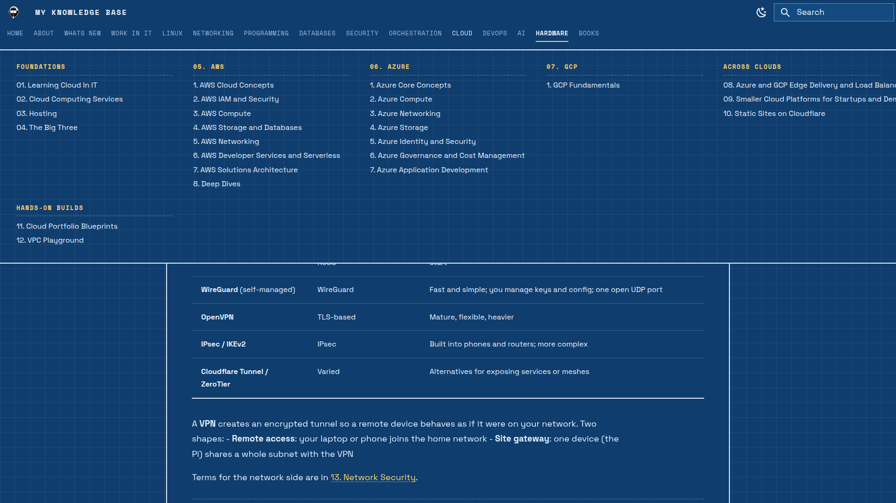
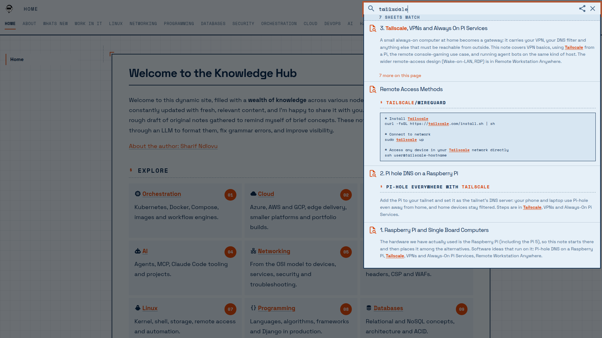
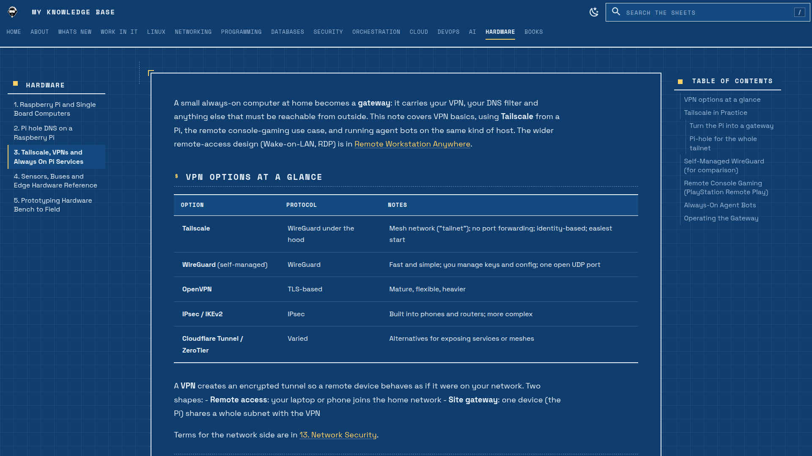
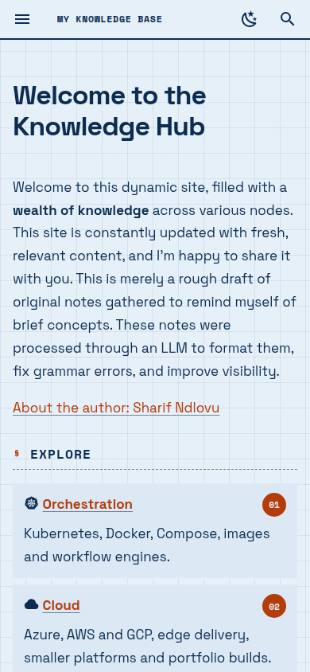
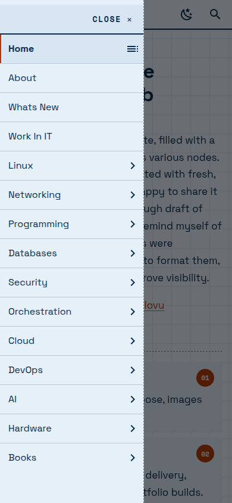
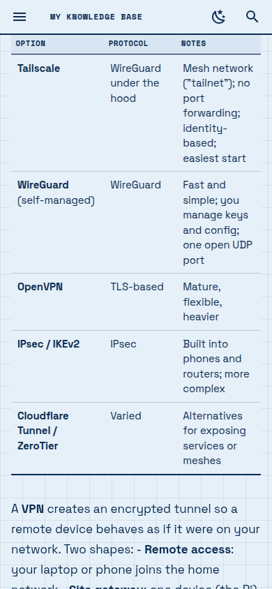
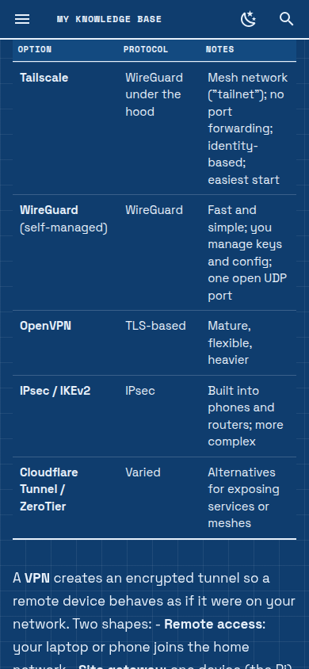

# mkdocs-blueprint

A drafting-sheet theme for MkDocs, built on [Material for MkDocs](https://squidfunk.github.io/mkdocs-material/). Paper-and-ink colours, a 32px blueprint grid, Space Grotesk and Space Mono type, dashed rules, numbered callout bubbles, ruled "drawing schedule" tables, a mega-menu navigation and a styled search. Install it with pip and set one line in `mkdocs.yml`.

Light is the default: pale blue paper with navy ink. Dark mode is a blue sheet with pale ink, chosen with the toggle. The accent is red-orange (light) or amber (dark).

**Demo:** this theme runs the author's own [Knowledge Hub](https://knowledgemap.devbridge.co.za), and the screenshots below are from it.








## On phones

Tables tighten to fit, code blocks get a single frame, the menu opens as a plain drawer and nothing scrolls sideways.

<p>
  
  
  
  
</p>

## Install

```
$ pip install mkdocs-blueprint
```

(Until it is on PyPI: `pip install git+https://github.com/sharifndlovu123/mkdocs-blueprint`.)

```yaml
theme:
  name: blueprint

plugins:
  - material/search   # note the prefix: Material only shows its search box for this name
```

That is all. The theme extends Material, so every Material option still works (`logo`, `favicon`, `features`, `palette`, extra plugins as `material/...`). Blueprint sets these defaults, and you can override any of them:

| Setting | Blueprint default |
| ------- | ----------------- |
| `palette` | light first, with a toggle to dark (the choice is remembered) |
| `font` | Space Grotesk and Space Mono |
| `language` | `custom` (search says "Search the sheets", "7 sheets match") |
| `features` | `navigation.tabs`, `navigation.tabs.sticky`, `navigation.sections`, `navigation.top`, `content.code.copy`, `search.highlight`, `search.suggest`, `toc.follow` |

Tip: number your folders and files (`01. Intro.md`) and the left rail becomes a sheet index.

## What it adds to Material

- **Mega-menu:** each top-level section is a tab; hovering or keyboard-focusing one opens a full-width panel of its sub-sections and pages. CSS-only, and long titles wrap (`partials/tabs.html`).
- **Search:** a boxed mono input with a `/` key hint and an index-style result list, stacked above the nav (`partials/search.html`, `partials/languages/custom.html`).
- **Accessible widgets:** the search dialog and the page-load bar get proper names, and each code block's action group gets a unique label (`partials/progress.html`, `assets/js/a11y.js`).

## Use only the CSS (no pip)

Prefer to stay on `theme: name: material`? Copy `mkdocs_blueprint/assets/css/blueprint.css` into your docs and add it:

```yaml
theme:
  name: material
  font: { text: Space Grotesk, code: Space Mono }
  features: [navigation.tabs, navigation.sections]
extra_css:
  - assets/css/blueprint.css
```

You then lose the mega-menu and the search wording, which live in the template partials. Copy `mkdocs_blueprint/partials/` into your own `overrides/partials/` and set `custom_dir: overrides` to get them back.

## Wide screens

From 1600px the page becomes a bordered "drawing sheet" with corner registration marks, tables and code run the full width and prose keeps a readable measure. On very wide screens (2000px) short top-level lists flow into two columns.

## Customise

All colours are variables at the top of `mkdocs_blueprint/assets/css/blueprint.css` (`--bp-paper`, `--bp-ink`, `--bp-red`, `--bp-muted`, `--bp-panel`, `--bp-grid`). Change those for a different ink or paper. Radius and shadows are removed globally with one rule near the top.

Add your own CSS after the theme with `extra_css` to change anything. Home page cards get numbered bubbles when you use Material's `grid cards` markup:

```markdown
<div class="grid cards" markdown>

- :material-cloud: **[Cloud](cloud.md)**

    Short description.

</div>
```

## Accessibility

Checked with WCAG 2.1 AA in mind, in both modes:

- Text and link colours meet **4.5:1** on every surface they sit on (light ink 12.0:1, light link red `#b43b0a` 4.6 to 5.1:1, muted 5.0 to 5.5:1; dark ink 9.6:1, amber 6.3 to 7.6:1). `tools/contrast.py` prints the ratios, so re-run it after changing a colour.
- Code highlighting tokens are set per mode so every token passes AA on the code background.
- Visible focus rings, underlined links, `prefers-reduced-motion` respected, no horizontal scroll at 375px.
- An axe-core scan (WCAG 2 A/AA plus best-practice) came back clean on the home page, a long note, tables and code pages in light and dark.
- The packaged partials (`search.html`, `progress.html`) and `a11y.js` fix two unlabelled Material widgets and give each code block's action group a unique name.
- The custom crosshair cursor is plain SVG in CSS, and falls back to the normal cursor on touch screens and in forced-colours mode.

## Notes

- Tested with Material for MkDocs 9.x (the sidebar width tweaks apply only at desktop widths, so the mobile drawer is unaffected). Fonts load from Google Fonts; self-host them if you need no external requests.
- Inspired by the blueprint skin of the author's CV site. The sample screenshots show the author's own notes; the theme itself contains no content.

## Licence

MIT. See `LICENSE`.
